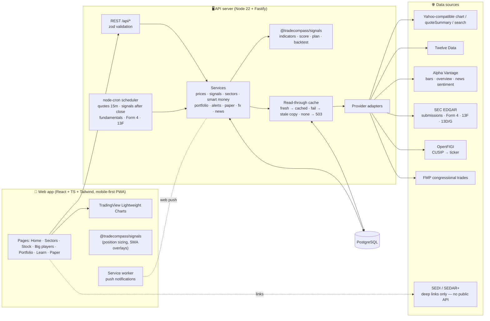

# TradeCompass — Architecture

## System diagram



### Request flow: `GET /api/signal/NVDA`
1. If the stored signal is newer than 30 min, return it.
2. Otherwise `getBars` checks `api_cache['bars:NVDA']`. If the copy is older than 1 h, it fetches 5 years of daily bars through the provider chain (`MARKET_DATA_PROVIDERS`, first success wins) and upserts them into `price_bars`.
   - If every provider fails, it serves the stored bars flagged `stale` with the error.
   - With no stored bars it returns **503 "Data unavailable"**. It never makes up data.
3. In parallel it loads fundamentals (24 h cache) and the macro series (^TNX, DXY, TIP÷IEF, the sector's commodity). Smart-money inputs come from `insider_trades` and `fund_holdings`.
4. `scoreSnapshot` → `buildPlan` → `backtest`. The payload is stored in `signals`. A label change is written to `signal_history` and fires `signal_change` alerts.

### Staleness rules
| Data | Fresh for | Marked stale when |
|---|---|---|
| Quote | 60 s while open / 15 min while closed | refresh failed, or exchange timestamp > 30 min old while the market is open |
| Daily bars | 1 h | refresh failed, or last bar > 4 days behind the last completed session |
| Fundamentals | 24 h | refresh failed (the factor is dropped if no data) |
| Filings (Form 4, 13D/G, congress) | 12 h | refresh failed |

The UI shows "Updated N min ago · source" everywhere and an amber banner when data is stale. Paper orders are **rejected** on stale quotes.

### US / Canada separation
- Market is derived from the symbol (`.TO` / `.V` → CA). Every list endpoint takes `market=US|CA` and filters on it, so the two markets never mix.
- Prices stay in native currency with a `US$` / `C$` label. Only the portfolio converts, into the user's base currency, using CADUSD=X. If FX is unavailable or implausible, foreign-currency positions are left out of totals and a warning is shown.
- Opening a stock switches the app's market toggle to that stock's market.

## Database schema

Full DDL: [`server/src/db/schema.sql`](../server/src/db/schema.sql). It is idempotent and applied on every start.

```mermaid
erDiagram
  users ||--o{ holdings : owns
  users ||--o{ watchlist : watches
  users ||--o{ alert_rules : sets
  users ||--o{ alert_events : receives
  users ||--o{ push_subscriptions : has
  users ||--o{ paper_accounts : "has (US, CA)"
  paper_accounts ||--o{ paper_positions : holds
  paper_accounts ||--o{ paper_trades : logs
  securities ||--o{ price_bars : "daily OHLCV"
  securities ||--o| quotes : latest
  securities ||--o| signals : current
  securities ||--o{ signal_history : changes
  securities ||--o{ insider_trades : "Form 4"
  funds ||--o{ fund_filings : "13F-HR"
  fund_filings ||--o{ fund_holdings : positions
  funds ||--o{ alert_rules : "fund_filing alerts"
  alert_rules ||--o{ alert_events : fires

  users { int id PK; text base_currency; float risk_pct }
  securities { text symbol PK; text market; text exchange; text currency; text sector; text kind; bool is_venture; bool cad_hedged }
  price_bars { text symbol PK; date d PK; float o; float h; float l; float c; bigint v }
  quotes { text symbol PK; float price; float prev_close; timestamptz as_of; text source; timestamptz fetched_at }
  api_cache { text key PK; jsonb payload; text source; timestamptz fetched_at }
  signals { text symbol PK; date as_of; int score; text label; text confidence; jsonb payload }
  funds { int id PK; text cik UK; text name; bool tracked; bool followed }
  fund_filings { int id PK; text accession UK; date period; date filed; bigint total_value }
  fund_holdings { bigint id PK; text cusip; text issuer; bigint value_usd; bigint shares; text put_call; text ticker }
  insider_trades { bigint id PK; text symbol; text insider; text role; text code; float shares; float price; date txn_date }
  holdings { int id PK; text symbol; float shares; float cost_per_share; text currency; text account }
  alert_rules { int id PK; text kind; text symbol; int fund_id; float threshold; bool active }
  paper_accounts { int id PK; text market; text currency; float cash; float starting }
```

## Scheduled jobs (America/New_York)
| Cron | Job | Does |
|---|---|---|
| `*/15 9-16 * * 1-5` | quotes | Refreshes quotes for the universe, watchlist, holdings and alert symbols when that market is open. Evaluates price alerts and paper stop/targets. |
| `20 17 * * 1-5` | signals | Bars, fundamentals, macro, signal and backtest for every tracked symbol. Fires signal-change alerts. |
| `0 6 * * 1-5` | fundamentals | Refreshes fundamentals, earnings and ex-dividend dates (alerts fire 3 days ahead). |
| `30 6 * * 1-5` | insiders | SEC Form 4 for US stocks. |
| `0 7 * * *` | funds | Checks tracked funds for new 13F-HR filings, resolves CUSIP→ticker and alerts followers. |

Run any job manually: `npm run jobs:run -w server -- signals` or `POST /api/admin/jobs/:job`.
